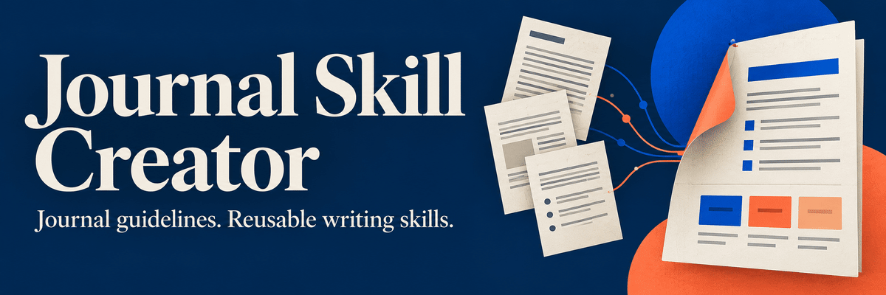

<p align="center">
  <a href="https://doi.org/10.5281/zenodo.23914245"></a>
  <a href="LICENSE"></a>
  <a href="https://agentskills.io/specification"></a>
  
</p>

**Turn any academic journal's author instructions into a reusable AI writing and manuscript-review skill.**

Name a journal and an article type. The creator researches the journal's official author instructions and builds a dedicated skill that drafts, checks and reviews manuscripts against that journal's rules.

- **Grounded in official sources.** Every word limit and mandatory rule is quoted from the publisher's own pages, with URL and access date. Explicit rules are kept apart from observed conventions.
- **Article-type aware.** Structure, abstract format, reference limits, reporting checklists and required statements for each article type.
- **Paragraph-level review.** A scientific review rubric scores each paragraph for submission readiness.
- **Visual review dashboard.** An offline HTML dashboard and an annotated PDF highlight each sentence from green to red, with a comment explaining its rating.
- **Honest about gaps.** Unavailable sources are reported, never guessed. The creator does not invent study results or citations.

## Demo

https://github.com/user-attachments/assets/e0615c82-9ea5-43b3-ac52-7afcbb12020f

## How it works

1. **Research.** The creator reads the journal's current author instructions, article-type pages and linked policies. If a source is paywalled or blocked, it stops and asks you for a PDF or pasted text.
2. **Generate.** It writes a self-contained `<journal>-writing` skill with the bundled sources, requirements, a writing-style guide, a review rubric and the dashboard renderer.
3. **Write and review.** Use the generated skill to outline, draft, revise, audit a submission or answer reviewers. It works offline from the bundled rules, and refreshes them only when you ask.

## Quick start

### Claude Code

Copy [`skills/journal-skill-creator`](skills/journal-skill-creator) into `~/.claude/skills/` for personal use, or into `.claude/skills/` inside a project. Start a new session and run:

```text
/journal-skill-creator Create a writing skill for European Radiology,
focusing on Original Research. Save the resulting skill in .claude/skills/.
Research the current official author instructions and record source limitations.
```

<details>
<summary><strong>Codex</strong></summary>

Ask Codex:

```text
$skill-installer install the skill from https://github.com/fabianrho/journal-skill-creator/tree/main/skills/journal-skill-creator
```

Or copy `skills/journal-skill-creator` into `~/.agents/skills/` manually and restart Codex if the skill does not appear. Then:

```text
Use $journal-skill-creator to create a writing skill for European Radiology,
focusing on Original Research. Research the current official author instructions
and ask me for any source you cannot open.
```

</details>

<details>
<summary><strong>Claude Desktop / claude.ai</strong></summary>

Download `journal-skill-creator.zip` from the [Releases page](https://github.com/fabianrho/journal-skill-creator/releases). In Claude, open **Customize → Skills → + → Create skill → Upload a skill**, upload the ZIP and enable it. Code execution must be enabled. Then:

```text
Use journal-skill-creator to create a writing skill for European Radiology,
focusing on Original Research. Package the resulting skill as a downloadable ZIP.
Provide dashboards as standalone HTML files or HTML artifacts when supported.
```

Upload the dedicated skill ZIP, whose top-level folder is `journal-skill-creator/`, not a ZIP of this whole repository.

</details>

## Responsible use

- **Independent project.** Not affiliated with, endorsed by or sponsored by any journal, publisher or society. Journal names are trademarks of their owners.
- **Verify before submitting.** Generated skills capture author instructions as of the access date they state. Always check the journal's current guidelines. Scores and review comments are heuristic aids, not predictions of editorial decisions.
- **Confidentiality.** Your manuscript text is processed by the AI provider you use. Do not upload manuscripts you are peer-reviewing, and do not include identifiable patient data or other restricted data. Follow your institution's and the journal's AI policies.
- **Disclose AI use.** Most journals require authors to disclose AI-assisted writing or editing (see [ICMJE](https://www.icmje.org/recommendations/) and [COPE](https://publicationethics.org/guidance/cope-position/authorship-and-ai-tools) guidance). Authors remain fully responsible for the content, and AI tools cannot be listed as authors.
- **Source material.** Generated skills may bundle copies of publisher pages for offline use. These keep their original terms, so do not redistribute them without permission.
- **Development.** This project was developed with the assistance of AI coding tools and reviewed by its authors.

## Requirements and limitations

- **Creating or refreshing** a journal skill needs web access to the official sources. The skill is created only after every required source has been read.
- **Generated skills work offline.** Each one bundles the official pages in `references/sources/`, verbatim where the publisher's terms allow, with URL, access date, capture method and completeness. Every output that relies on journal rules states its access date, for example *Requirements accessed 2026-10-07 (bundled)*.
- **The dashboard renderer** needs Python 3 and its standard library only. It produces a self-contained HTML file with an **Export annotated PDF** button, and works in a browser or as a Claude HTML artifact.
- **Portability.** The skill uses the shared [Agent Skills](https://agentskills.io/specification) format. Other agents can use it if they support that format and provide research and file tools. `agents/openai.yaml` adds optional Codex UI metadata. A separate skill-creator helper is optional.
- **No built-in rule database.** Journal rules are researched each time the creator runs. The creator itself does not ship rules for any journal.
- **Not a substitute for expert review.** The tool does not verify statistics, data or the accuracy of references.

<details>
<summary><strong>Package contents</strong></summary>

```text
skills/journal-skill-creator/
├── SKILL.md
├── LICENSE
├── agents/openai.yaml
├── references/generated-skill-contract.md
├── assets/review/
│   ├── critical-review.md
│   ├── paragraph-readiness.md
│   ├── review-dashboard.md
│   ├── dashboard-data.md
│   └── dashboard-template.html
└── scripts/render_review_dashboard.py
```

Some links in the review templates point to `journal-requirements.md` and `writing-style.md`. Those files are written for each target journal when a skill is generated, and the creator adapts the template links to their destination.

</details>

## Citation

If this tool supports your work, please cite it:

> Hoitsma F, Coelho T. Journal Skill Creator [software]. Zenodo. https://doi.org/10.5281/zenodo.23914245

This DOI always resolves to the latest version. Version-specific DOIs and other formats (BibTeX, APA) are available on the [Zenodo record](https://doi.org/10.5281/zenodo.23914245) and through GitHub's **Cite this repository** button.

## Contributing

Issues are welcome.

## Further reading

- [Agent Skills specification](https://agentskills.io/specification)
- [Claude Code skills](https://code.claude.com/docs/en/skills)
- [Skills in Claude](https://support.claude.com/en/articles/12512180-use-skills-in-claude)
- [Codex skills](https://learn.chatgpt.com/docs/build-skills)

## License

MIT. See [LICENSE](LICENSE). Journal websites, articles and other external sources keep their own terms.
